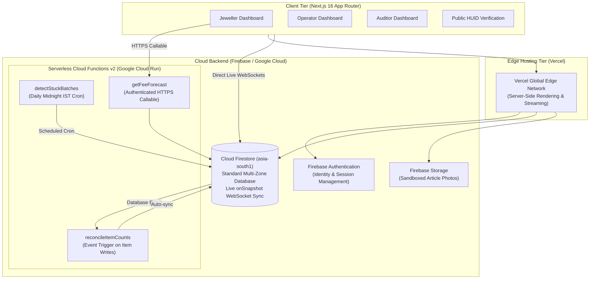

# HUIDLedger

> **"One secure, real-time ledger for every hallmarking batch."**

HUIDLedger is a cloud-native, multi-tenant digital ledger built for India's gold jewellery manufacturing supply chain. It replaces vulnerable paper registers and fragmented WhatsApp tracking with an automated, synchronized, and tamper-resistant cloud platform connecting Jewellers, Assaying & Hallmarking Centres (AHCs), Compliance Auditors, and Retail Consumers.

---

## 1. Problem Statement & Real-World Domain

In India, mandatory Bureau of Indian Standards (BIS) regulations require gold jewellery articles to undergo rigorous purity assaying and receive a **6-character alphanumeric Hallmark Unique ID (HUID)** before sale.

### Industry Bottlenecks Solved:
- **Zero Real-Time Visibility**: Mid-size jewellers traditionally track batches sent to AHCs over phone calls, paper slips, and WhatsApp chats. When batches get delayed or stuck at testing stages, neither party has clear audit trails.
- **Disconnected Rejections**: Articles that fail purity testing are often documented separately on paper, creating discrepancies between initial dispatched weights and returned inventory.
- **Manual Reconciliation Errors**: Matching 6-character HUIDs stamped on physical jewellery against sales invoices and billing records is error-prone, resulting in tax mismatch notices and billing disputes.
- **Rising Operational Costs**: Hallmarking fees have increased, yet jewellers lack automated visibility into their monthly and annual hallmarking expenditures.

### The Cloud Solution:
HUIDLedger leverages Google Cloud Platform and Firebase to provide a single, synchronized source of truth across geographically distributed jewellers and assaying centres without requiring either to manage servers, databases, or networking infrastructure.

---

## 2. User Roles & Capabilities

| Role | Key Capabilities |
| :--- | :--- |
| **Jeweller** | • Create hallmarking batches and add detailed articles with weights & purities.<br>• Upload high-resolution article photographs directly to cloud storage.<br>• Real-time batch progression tracking via live database subscriptions.<br>• Dynamic hallmarking cost estimation and serverless forecasting.<br>• Link verified HUIDs to sales invoice numbers for tax reconciliation. |
| **AHC Operator** | • View and claim unassigned submitted batches.<br>• Advance batches through a strict, forward-only status machine.<br>• Record article testing outcomes (`hallmarked` vs. `rejected` with reasons).<br>• Inscribe and assign unique 6-character HUIDs. |
| **Auditor** | • Read-only compliance oversight across all jewellers, centres, and batches.<br>• Multi-dimensional filtering by status, jeweller, and date range.<br>• Real-time performance analytics (average turnaround time, rejection rates).<br>• One-click CSV audit ledger export for regulatory reporting. |
| **Public Consumer** | • Zero-login public verification portal (`/verify`) to authenticate any 6-character HUID and view purity, category, weight, and hallmarking centre. |

---

## 3. Architecture Overview



---

## 4. Cloud Services Used & Justification

### 1. Firebase Authentication
- **Why**: Provides secure, managed identity without requiring custom credential databases, token hashing logic, or session cookie maintenance.
- **Features Used**: Email/Password authentication, secure JWT tokens, and client state listeners.

### 2. Cloud Firestore (`asia-south1` Mumbai)
- **Why**: Ultra-low latency document database with multi-zone replication in India, offering real-time `onSnapshot` synchronization across disparate locations.
- **Features Used**: Atomic batch writes, nested subcollections (`batches/{id}/items`), compound queries, and granular server-side Security Rules.

### 3. Firebase Storage
- **Why**: Direct-to-bucket client uploads with presigned security enforcement, offloading heavy media processing from application servers.
- **Features Used**: Path-based isolation (`batch-photos/{uid}/**`), strict `image/*` MIME validation, 2 MB size restrictions, and global CDN delivery.

### 4. Google Cloud Functions v2 (Cloud Run Serverless)
- **Why**: Event-driven microservices that run without maintaining idle compute instances, scaling to zero when not in use.
- **Features Used**:
  - `detectStuckBatches`: Scheduled cron trigger (`onSchedule`) checking batch staleness.
  - `reconcileItemCounts`: Firestore trigger (`onDocumentWritten`) ensuring mathematical consistency and managing public HUID certificates.
  - `getFeeForecast`: Authenticated HTTPS callable function (`onCall`) enforcing server-side role validation and financial projection modeling.

### 5. Vercel Global Edge Network
- **Why**: High-performance hosting with zero server maintenance, automatic HTTPS/SSL, partial pre-rendering (PPR), and seamless GitHub CI/CD automation.

---

## 5. Cloud Computing Concepts Demonstrated

- **Real-Time Data Synchronization**: Both Jewellers and Operators receive instant updates via persistent WebSockets/SSE (`onSnapshot`) without refreshing their browsers or polling APIs.
- **Role-Based Access Control (RBAC)**: Defense-in-depth model where access permissions are enforced at the database level through declarative `firestore.rules` and checked on callable Cloud Functions.
- **Serverless Event-Driven Architecture (FaaS)**: Eliminates 24/7 virtual machines. Background tasks run automatically in response to database mutations or timer triggers.
- **Elastic Auto-Scaling**: Cloud Functions and Cloud Firestore seamlessly handle traffic spikes during peak festive jewellery delivery seasons without capacity planning.
- **High Availability & Fault Tolerance**: Managed multi-zone cloud infrastructure guarantees 99.99% database uptime and zero data loss.
- **Backend-as-a-Service (BaaS)**: Shifts infrastructure operational overhead (OS updates, database patches, network routing) entirely to Google Cloud.

---

## 6. Data Model (Cloud Firestore)

```
users/{uid}
├── uid: string
├── name: string
├── email: string
├── role: "jeweller" | "operator" | "auditor"
├── shopName: string | null        (jeweller only)
├── centreName: string | null      (operator only)
└── createdAt: Timestamp

batches/{batchId}
├── batchCode: string              (e.g., "HB-2026-0001")
├── jewellerId: string
├── jewellerName: string
├── shopName: string | null
├── operatorId: string | null
├── operatorName: string | null
├── centreName: string | null
├── status: "submitted" | "received" | "tested" | "hallmarked" | "returned"
├── itemCount: number
├── pendingCount: number
├── hallmarkedCount: number
├── rejectedCount: number
├── feePerItem: number             (frozen from config at creation)
├── estimatedFee: number           (itemCount * feePerItem)
├── notes: string | null
├── createdAt: Timestamp
├── updatedAt: Timestamp
├── lastStatusChangeAt: Timestamp
├── isStuck: boolean               (managed by Cloud Functions)
└── statusHistory: Array<{ status, changedAt, changedByUid, changedByName }>

batches/{batchId}/items/{itemId}   [Subcollection]
├── name: string                   (e.g., "22K Gold Bangle")
├── category: "ring" | "chain" | "bangle" | "earring" | "pendant" | "necklace" | "other"
├── purity: "24K" | "22K" | "18K" | "14K"
├── weightGrams: number
├── photoUrl: string | null
├── photoPath: string | null       (Storage path for cleanup)
├── result: "pending" | "hallmarked" | "rejected"
├── huid: string | null            (6 chars uppercase, regex: ^[A-Z0-9]{6}$)
├── rejectionReason: string | null
├── invoiceNo: string | null       (linked by jeweller post-hallmarking)
├── createdAt: Timestamp
└── updatedAt: Timestamp

publicHuids/{huid}
├── huid: string                   (Document ID, e.g., "AB1234")
├── batchId: string
├── batchCode: string
├── centreName: string
├── category: string
├── purity: string
├── weightGrams: number
├── hallmarkedAt: Timestamp
└── verified: boolean

config/app
├── feePerItem: number             (Default: 75)
├── stuckAfterDays: number         (Default: 3)
├── updatedAt: Timestamp
└── updatedByUid: string
```

---

## 7. Security Model

Security is enforced using a **Zero-Trust, Defense-in-Depth** architecture:

1. **Role Immutability**: A user's assigned role (`jeweller`, `operator`, `auditor`) can never be altered via client requests once registered.
2. **Forward-Only State Machine**: Batches can only progress forward: `submitted` &rarr; `received` &rarr; `tested` &rarr; `hallmarked` &rarr; `returned`. Retrograde transitions are rejected at the database level.
3. **Subcollection Safeguards**: Jewellers can only add, edit, or delete items while a batch is in `submitted` status. Operators can only update `result`, `huid`, and `rejectionReason` during `received` or `tested` statuses.
4. **Public Read Lockdown**: The public verification collection (`publicHuids`) allows single-document `get` requests (`/verify?huid=...`) but strictly denies `list` requests, preventing scraping or data harvesting of the entire registry.
5. **Storage Isolation**: Uploads are restricted to authenticated users writing strictly to `batch-photos/{uid}/**` with verified `image/*` MIME headers and a 2 MB size ceiling.

---

## 8. Local Setup & Development

### Prerequisites
- Node.js 20 or 22 LTS
- Git

### Installation
```bash
# 1. Clone the repository
git clone https://github.com/dhruv1307/huidledger.git
cd huidledger

# 2. Install root dependencies
npm install

# 3. Create .env.local with your Firebase credentials
# (Refer to .env.local template below)

# 4. Start Next.js development server
npm run dev
```

### Environment Variables (`.env.local`)
```env
NEXT_PUBLIC_FIREBASE_API_KEY=AIzaSy...
NEXT_PUBLIC_FIREBASE_AUTH_DOMAIN=huidledger.firebaseapp.com
NEXT_PUBLIC_FIREBASE_PROJECT_ID=huidledger
NEXT_PUBLIC_FIREBASE_STORAGE_BUCKET=huidledger.firebasestorage.app
NEXT_PUBLIC_FIREBASE_MESSAGING_SENDER_ID=9079929809
NEXT_PUBLIC_FIREBASE_APP_ID=1:9079929809:web:...
```

---

## 9. Production Deployment

### A. Deploy Frontend to Vercel
1. Push your repository to GitHub.
2. In the [Vercel Dashboard](https://vercel.com/), import the repository.
3. Go to **Settings** &rarr; **Environment Variables** and add all 6 `NEXT_PUBLIC_FIREBASE_*` variables for **Production**, **Preview**, and **Development**.
4. Click **Deploy**.

### B. Authorize Vercel Domain in Firebase
1. Open [Firebase Console](https://console.firebase.google.com/) &rarr; **Authentication** &rarr; **Settings** &rarr; **Authorized domains**.
2. Click **Add domain** and enter your Vercel deployment URL (e.g., `huidledger.vercel.app`).

### C. Deploy Security Rules & Cloud Functions
```bash
# 1. Install Firebase CLI
npm install -g firebase-tools

# 2. Login to Firebase
firebase login

# 3. Build Cloud Functions
cd functions
npm install
npm run build
cd ..

# 4. Deploy rules, storage, and functions
firebase deploy --only firestore:rules,storage,functions
```

---

## 10. Known Limitations & Future Roadmap

1. **Direct BIS Portal Integration**: Direct API handshake with the official BIS portal (`manakonline.in`) for automated HUID issuance and compliance verification.
2. **AI Optical Character Recognition (OCR)**: Utilizing computer vision to read micro-laser engraved 6-character HUIDs directly from gold jewellery under magnification.
3. **Barcoding & QR Printing**: Generating thermal label barcodes for physical batch pouches to allow rapid scanning upon arrival at Assaying Centres.
4. **IoT Bluetooth Weighing Scale Integration**: Direct serial/BLE integration with analytical balance scales (0.001g precision) to eliminate manual weight entry.
5. **Administrative User Management**: A master admin interface for managing jewellery shop licenses and AHC accreditations.
6. **Offline IndexedDB Caching**: Enabling offline article entry for jewellers located in rural areas with intermittent connectivity.
